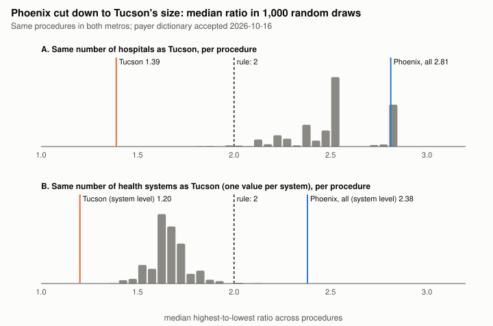
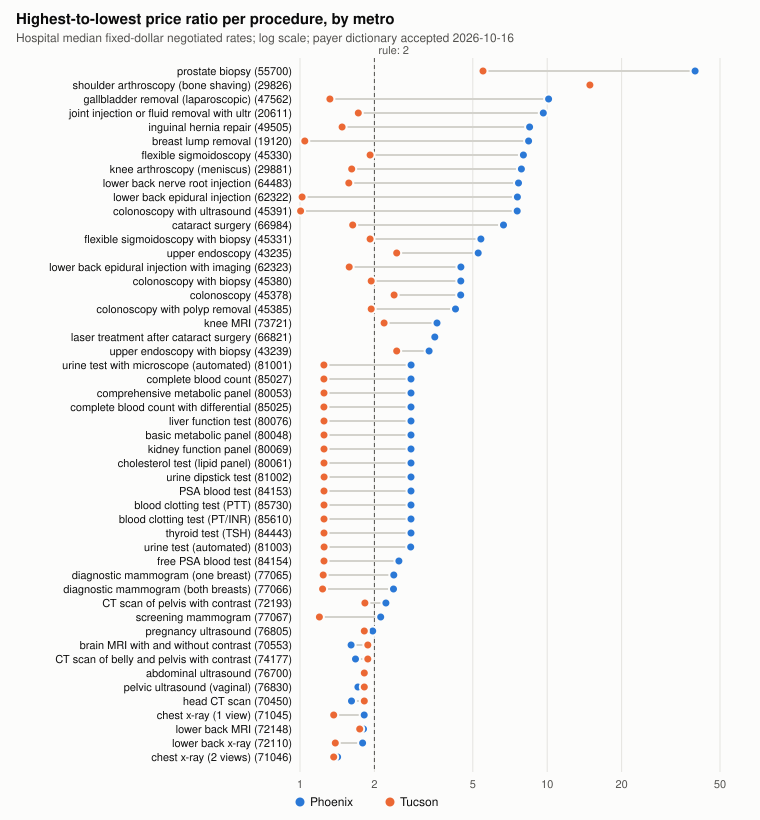

# H2 follow-up for Dr. Li (meeting 2026-10-16)

**PROVISIONAL.** All figures use the payer dictionary of 2026-10-13, which is not accepted yet (inter-rater round
1: 68%, target 85%; round 2 not scored). They become final only after round 2 passes and the scripts are re-run.

Reproduce: `python -m research.h2.fetch_context` (public context data), then `python -m research.h2.advisor_followup`
(seed 20261016; repeated runs give identical output). The script first checks that it reproduces every ratio in
data/processed/h2_provisional_by_procedure.csv. It reads only the 19 H1 sample hospitals.

Comparable rate, as pre-registered in research/h2/REPORT.md: a fixed dollar negotiated rate of one of the 11
canonical insurers, facility (or blank) billing class, outpatient or both, surviving the F4 rules. For each
launch procedure and metro with at least 2 hospitals: ratio = highest / lowest hospital median rate.
14 hospitals publish such rates: 9 in Phoenix (7 systems), 5 in Tucson (3 systems).

## 1. Primary (pre-registered): pooled median across both metros
| | Median ratio | 95% CI | Procedure-metro pairs |
|---|---|---|---|
| **Pooled, both metros (decision rule)** | **1.92** | 1.82 - 2.40 | 99 |

CI: bootstrap, 10,000 draws, resampling the 50 procedures (a procedure carries its Phoenix and Tucson ratios
together, so the two metros' ratios for the same code are not treated as independent). In 21.7% of draws the
pooled median is 2 or more. **Under the pre-registered rule (median of at least 2) H2 is not met on provisional
data, but the CI includes 2.** Table 13 then says the project reframes around interpretation and provenance.

## 2. Secondary: per metro
| Metro | Median ratio | 95% CI | Procedures | Ratio >= 2 | Hospitals with comparable rates | Hospitals per procedure | Systems per procedure |
|---|---|---|---|---|---|---|---|
| Phoenix | 2.81 | 2.81 - 3.90 | 50 | 40 of 50 | 9 | median 7 (5-9) | median 5 (4-7) |
| Tucson | 1.39 | 1.25 - 1.74 | 49 | 6 of 49 | 5 | median 5 (2-5) | median 3 (2-3) |

Notes:
- The Phoenix CI's lower end equals its median because 14 Phoenix procedures (the lab tests) have the same
  ratio, 2.81. In all 14 the highest hospital median is an HonorHealth hospital and the lowest is Abrazo Central
  or Arizona Spine and Joint (for example CBC 85025: $19.66 vs $6.99). A constant ratio across 14 tests suggests
  both price labs off a common fee schedule at different percentages; this is not verified. Across all Phoenix
  procedures, an HonorHealth hospital has the highest median most often; Abrazo Central or Chandler Regional the
  lowest.
- In Tucson, Oro Valley (Northwest Healthcare) has the highest hospital median in 41 of 50 procedures; TMC or Banner UMC
  Tucson has the lowest. Laser treatment after cataract surgery (66821) has fewer than 2 Tucson hospitals.

## 3. Does Tucson's smaller hospital count explain the difference?
A metro with fewer hospitals mechanically tends to have a smaller highest-to-lowest ratio. Two checks on the 49
procedures both metros have, each with 1,000 random draws (data/processed/h2_followup_subsample.csv):

| Check | Phoenix, all | Phoenix cut to Tucson's size: median of draws (2.5 - 97.5%) | Draws >= 2 | Tucson |
|---|---|---|---|---|
| A. Same **number of hospitals** as Tucson, per procedure | 2.81 | **2.53** (2.12 - 2.81) | 99.1% | 1.39 |
| B. Same **number of health systems** as Tucson, one value per system (median of its hospitals) | 2.38 | **1.66** (1.49 - 1.86) | 0.4% | 1.20 |

Reading:
- **Hospital count alone explains little.** Cut to Tucson's hospital count, Phoenix still has a median of 2.53,
  and no draw comes down to Tucson's 1.39.
- **The number of independent systems matters a lot.** Tucson's 5 hospitals come from only 3 systems, and the 3
  Northwest Healthcare hospitals price almost identically, so Tucson effectively has 3 price setters. Phoenix
  cut to 3 systems drops to 1.66, below 2 in 99.6% of draws. Tucson at system level (1.20) is still lower than
  that, so part of the gap remains after this adjustment.
- Implication for the pooled rule: the pooled median mixes two markets with different numbers of independent
  price setters. This is a reason to report both metros next to the pooled result, as Dr. Li asked, not a reason
  to change the pre-registered rule.

## 4. Exploratory (descriptive only, not a test): hospital-level factors
About 14 hospitals publish comparable rates, so nothing here supports a claim about causes. Price index = median,
over the procedures a hospital prices, of (hospital median / median of all hospital medians for that procedure);
1.00 = typical hospital across both metros (data/processed/h2_followup_hospital_index.csv).

| Metro | Hospital | System | CMS ownership | Certified beds | Procedures | Price index |
|---|---|---|---|---|---|---|
| Phoenix | Chandler Regional Medical Center | Dignity Health | Voluntary non-profit - Private | 429 | 48 | 0.86 |
| Phoenix | Abrazo Central Campus | Abrazo (Tenet) | Physician | 206 | 50 | 0.87 |
| Phoenix | Arizona Spine and Joint Hospital | USPI | Physician | 23 | 19 | 0.88 |
| Phoenix | St. Joseph's Hospital and Medical Center | Dignity Health | Voluntary non-profit - Church | 586 | 50 | 0.98 |
| Phoenix | Valleywise Health Medical Center | Valleywise Health | Government - Local | 758 | 50 | 0.99 |
| Phoenix | Banner Desert Medical Center | Banner Health | Voluntary non-profit - Private | 595 | 44 | 1.00 |
| Phoenix | Mayo Clinic Hospital (Phoenix) | Mayo Clinic | Voluntary non-profit - Private | 280 | 14 | 1.12 |
| Phoenix | HonorHealth Deer Valley Medical Center | HonorHealth | Voluntary non-profit - Private | 204 | 50 | 1.41 |
| Phoenix | HonorHealth Scottsdale Osborn Medical Center | HonorHealth | Proprietary | 341 | 50 | 1.41 |
| Tucson | Banner - University Medical Center Tucson | Banner Health | Voluntary non-profit - Private | 625 | 46 | 0.98 |
| Tucson | Tucson Medical Center | TMC Health | Voluntary non-profit - Private | 596 | 50 | 0.99 |
| Tucson | Northwest Medical Center | Northwest Healthcare | Proprietary | 300 | 45 | 1.17 |
| Tucson | Northwest Medical Center Sahuarita | Northwest Healthcare | Voluntary non-profit - Private | 18 | 44 | 1.17 |
| Tucson | Oro Valley Hospital | Northwest Healthcare | Proprietary | 146 | 44 | 1.28 |

What the table shows, without over-claiming:
- Price level follows the **health system** more than the metro: both HonorHealth hospitals sit at 1.41, both
  Dignity hospitals at 0.86-0.98, the three Northwest hospitals at 1.17-1.28. Banner's Tucson and Phoenix
  hospitals are both at about 1.00.
- Tucson's median hospital (1.17) is priced above Phoenix's (0.99), because 3 of Tucson's 5 hospitals are
  Northwest. So Tucson is not "cheaper"; it has a narrower spread.
- Beds: Spearman rank correlation of price index with certified beds is -0.31 (n = 14). With n = 14 this is
  compatible with no relation.
- Ownership labels are CMS's own and some look inconsistent with system ownership (HonorHealth Osborn
  "Proprietary" while Deer Valley is non-profit; Abrazo Central "Physician"; Northwest Sahuarita "Voluntary
  non-profit" while the other two Northwest hospitals are "Proprietary"). They are reported as published, not
  corrected; ownership is not a usable factor until checked.
- **ZIP-level median household income and uninsured rate: not obtained.** The Census API now requires a key
  (requests without one are redirected to missing_key.html, 2026-10-16), contrary to the earlier "no key needed
  for small requests". research/h2/fetch_context.py is ready: with CENSUS_API_KEY in .env it fills ACS 5-year
  2024 table B19013 (variable B19013_001E, median household income) and subject table S2701 (S2701_C05_001E,
  percent uninsured) for each hospital's ZCTA. A free key takes a few minutes
  (https://api.census.gov/data/key_signup.html).

Sources: CMS Hospital General Information, dataset xubh-q36u
(https://data.cms.gov/provider-data/dataset/xubh-q36u), retrieved 2026-10-16; CMS Provider of Services file,
Hospital & Non-Hospital Facilities, release of 2025-04-02 (dataset 4bdd6342-510f-42fd-9a75-3068e84d80ec), field
CRTFD_BED_CNT, retrieved 2026-10-16. A newer POS release may exist; bed counts can be stale.

## 5. Per procedure

Table view of the chart (data/processed/h2_followup_ratios.csv):

| Procedure (code) | Phoenix ratio | Phoenix hospitals / systems | Tucson ratio | Tucson hospitals / systems |
|---|---|---|---|---|
| prostate biopsy (55700) | 39.66 | 7 / 5 | 5.50 | 3 / 3 |
| shoulder arthroscopy (bone shaving) (29826) | 15.03 | 8 / 6 | 14.88 | 5 / 3 |
| gallbladder removal (laparoscopic) (47562) | 10.13 | 7 / 5 | 1.32 | 5 / 3 |
| joint injection or fluid removal with ultrasound (20611) | 9.64 | 8 / 6 | 1.72 | 5 / 3 |
| inguinal hernia repair (49505) | 8.48 | 7 / 5 | 1.48 | 5 / 3 |
| breast lump removal (19120) | 8.41 | 7 / 5 | 1.05 | 5 / 3 |
| flexible sigmoidoscopy (45330) | 8.01 | 7 / 5 | 1.92 | 5 / 3 |
| knee arthroscopy (meniscus) (29881) | 7.86 | 8 / 6 | 1.62 | 5 / 3 |
| lower back nerve root injection (64483) | 7.65 | 8 / 6 | 1.57 | 2 / 2 |
| lower back epidural injection (62322) | 7.58 | 7 / 5 | 1.02 | 2 / 2 |
| colonoscopy with ultrasound (45391) | 7.56 | 6 / 4 | 1.01 | 2 / 2 |
| cataract surgery (66984) | 6.66 | 6 / 4 | 1.63 | 2 / 2 |
| flexible sigmoidoscopy with biopsy (45331) | 5.39 | 7 / 5 | 1.92 | 5 / 3 |
| upper endoscopy (43235) | 5.26 | 7 / 5 | 2.46 | 5 / 3 |
| lower back epidural injection with imaging (62323) | 4.48 | 8 / 6 | 1.58 | 5 / 3 |
| colonoscopy with biopsy (45380) | 4.47 | 7 / 5 | 1.94 | 5 / 3 |
| colonoscopy (45378) | 4.47 | 7 / 5 | 2.40 | 5 / 3 |
| colonoscopy with polyp removal (45385) | 4.26 | 7 / 5 | 1.94 | 5 / 3 |
| knee MRI (73721) | 3.58 | 6 / 5 | 2.19 | 5 / 3 |
| laser treatment after cataract surgery (66821) | 3.51 | 6 / 4 | - | - |
| upper endoscopy with biopsy (43239) | 3.33 | 7 / 5 | 2.46 | 5 / 3 |
| urine test with microscope (automated) (81001) | 2.81 | 9 / 7 | 1.25 | 5 / 3 |
| complete blood count (85027) | 2.81 | 9 / 7 | 1.25 | 5 / 3 |
| comprehensive metabolic panel (80053) | 2.81 | 9 / 7 | 1.25 | 5 / 3 |
| complete blood count with differential (85025) | 2.81 | 9 / 7 | 1.25 | 5 / 3 |
| liver function test (80076) | 2.81 | 9 / 7 | 1.25 | 5 / 3 |
| basic metabolic panel (80048) | 2.81 | 9 / 7 | 1.25 | 5 / 3 |
| kidney function panel (80069) | 2.81 | 8 / 6 | 1.25 | 5 / 3 |
| cholesterol test (lipid panel) (80061) | 2.81 | 9 / 7 | 1.25 | 5 / 3 |
| urine dipstick test (81002) | 2.81 | 7 / 5 | 1.25 | 5 / 3 |
| PSA blood test (84153) | 2.81 | 9 / 7 | 1.25 | 5 / 3 |
| blood clotting test (PTT) (85730) | 2.81 | 9 / 7 | 1.25 | 5 / 3 |
| blood clotting test (PT/INR) (85610) | 2.81 | 9 / 7 | 1.25 | 5 / 3 |
| thyroid test (TSH) (84443) | 2.81 | 9 / 7 | 1.25 | 5 / 3 |
| urine test (automated) (81003) | 2.80 | 9 / 7 | 1.25 | 5 / 3 |
| free PSA blood test (84154) | 2.51 | 8 / 6 | 1.25 | 5 / 3 |
| diagnostic mammogram (one breast) (77065) | 2.39 | 5 / 4 | 1.24 | 4 / 2 |
| diagnostic mammogram (both breasts) (77066) | 2.39 | 6 / 4 | 1.23 | 4 / 2 |
| CT scan of pelvis with contrast (72193) | 2.23 | 7 / 5 | 1.83 | 5 / 3 |
| screening mammogram (77067) | 2.12 | 6 / 4 | 1.20 | 4 / 2 |
| pregnancy ultrasound (76805) | 1.97 | 7 / 5 | 1.82 | 5 / 3 |
| brain MRI with and without contrast (70553) | 1.61 | 7 / 5 | 1.88 | 5 / 3 |
| CT scan of belly and pelvis with contrast (74177) | 1.68 | 7 / 5 | 1.88 | 5 / 3 |
| abdominal ultrasound (76700) | 1.82 | 7 / 5 | 1.82 | 5 / 3 |
| pelvic ultrasound (vaginal) (76830) | 1.71 | 7 / 5 | 1.82 | 5 / 3 |
| head CT scan (70450) | 1.62 | 7 / 5 | 1.82 | 5 / 3 |
| chest x-ray (1 view) (71045) | 1.82 | 8 / 6 | 1.37 | 5 / 3 |
| lower back MRI (72148) | 1.81 | 7 / 5 | 1.74 | 5 / 3 |
| lower back x-ray (72110) | 1.79 | 7 / 5 | 1.39 | 5 / 3 |
| chest x-ray (2 views) (71046) | 1.42 | 8 / 6 | 1.37 | 5 / 3 |

## Limitations
- Provisional payer dictionary (see top).
- 14 hospitals with comparable rates; Tucson has 3 systems. Every per-metro statement rests on few price setters.
- Parser issue found while building the advisor pack: in tall CSV files, a second chargemaster line with the same
  code, description, setting and modifiers keeps only the first line's gross and cash (docs/PROGRESS.md). It
  affects cash and gross figures only, not the negotiated rates used here.
- Only fixed dollar rates of canonical insurers are compared; percent of charges and algorithm rates (most of
  Mayo's and TMC's) are excluded by the pre-registered definition.
