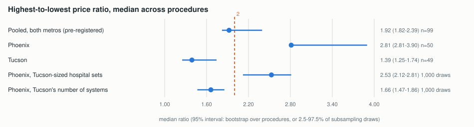
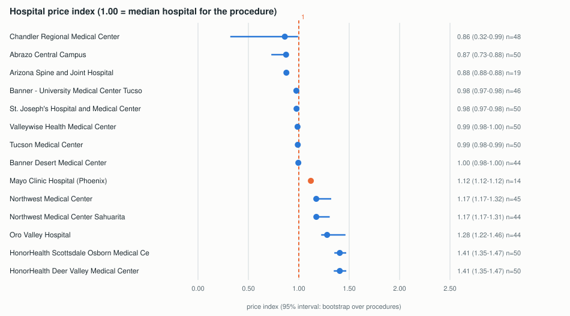
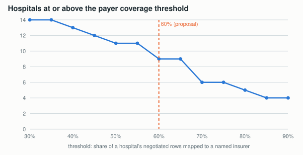

# Follow-up for Dr. Li, round 2 (2026-11-02)

Requests from the meeting of 2026-10-16: show H2 as estimates with intervals; compare Mayo with all other
hospitals; test the 60% coverage threshold; check how completeness weights change the hospital ranking.
Reproduce: `python -m research.h2.li_round2` (seed 20261102, deterministic). Same comparable-rate definition as
the pre-registered H2 (research/h2/REPORT.md); 14 hospitals publish comparable rates.

## 1. H2 as estimates with 95% intervals

| Estimate | Median ratio | 95% interval |
|---|---|---|
| Pooled, both metros (pre-registered decision rule) | 1.92 | 1.82 - 2.39 |
| Phoenix | 2.81 | 2.81 - 3.90 |
| Tucson | 1.39 | 1.25 - 1.74 |
| Phoenix limited to Tucson's hospital count per procedure | 2.53 | 2.12 - 2.81 |
| Phoenix limited to Tucson's number of health systems | 1.66 | 1.47 - 1.86 |

Intervals: bootstrap over procedures (10,000 draws) for the first three; 2.5-97.5% of 1,000 subsampling draws
for the last two. The pooled interval includes 2, so the yes/no verdict (not met) is fragile; the clearer finding
is the metro difference, and that it shrinks to below 2 once Phoenix is limited to Tucson's number of systems:
**prices vary by health system more than by hospital**.

## 2. Mayo Clinic compared with every other hospital

- Price index (hospital median rate / median hospital for the procedure, median over procedures): Mayo **1.12**,
  rank 9 of 14. HonorHealth (1.41) and Northwest (1.17-1.28) are higher; Dignity, Abrazo and Arizona Spine and
  Joint lower.
- Mayo publishes comparable fixed dollar rates for only **14** launch procedures (others 44-50). In all 14 Mayo's
  median is above the median of the other hospitals, by the same factor: median 1.12, interval 1.12-1.13. A
  constant factor suggests a fee schedule applied as a fixed percentage; not verified.
- Payer coverage: Mayo 48.3% of 51.8 million negotiated rows (85% of all rows in the sample); the other 13
  hospitals' median is 68.2% (38.2%-100%). Mayo alone decides the pooled coverage verdict (section 3).

## 3. Sensitivity of the 60% coverage threshold

| Threshold | Hospitals passing (of 14) | Pooled, with Mayo | Pooled, without Mayo | Mean of hospitals |
|---|---|---|---|---|
| 30-35% | 14 | pass | pass | pass |
| 40% | 13 | pass | pass | pass |
| 45% | 12 | pass | pass | pass |
| 50% | 11 | pass | pass | pass |
| 55% | 11 | fail | pass | pass |
| **60%** | **9** | **fail** | **pass** | **pass** |
| 65% | 9 | fail | pass | pass |
| 70% | 6 | fail | fail | pass |
| 75% | 6 | fail | fail | fail |
| 80% | 5 | fail | fail | fail |
| 85-90% | 4 | fail | fail | fail |

- 60% sits on a plateau: the same 9 hospitals pass from 60% to 65%; moving to 55% adds 2, to 70% removes 3.
- The pooled verdict with Mayo changes between 50% and 55%; without Mayo between 65% and 70%; the mean of
  hospitals between 70% and 75%. Conclusions about individual hospitals are stable in 60-65%; the pooled verdict
  depends mainly on Mayo, as reported earlier.
- Literature: we did not find a published standard for the share of payer names that must be mapped before a
  per-insurer comparison is shown. We propose to report the threshold as a design choice with this sensitivity
  table, rather than cite a number.

## 4. Completeness score weights: 10,000 random weight sets
Weights drawn uniformly over all ways to split 100 points among the 5 components (flat Dirichlet), each component
scaled 0-1 (data/processed/li2_weights_rank_stability.csv).

| Hospital | Equal-weight score | Equal-weight rank | Median rank | 5-95% rank | Top 5 | Bottom 5 |
|---|---|---|---|---|---|---|
| East Valley ER & Hospital | 100.0 | 1 | 1 | 1-1 | 100% | 0% |
| St. Mary's Hospital | 98.7 | 3 | 3 | 3-5 | 100% | 0% |
| St. Joseph's Hospital (Tucson) | 98.7 | 2 | 2 | 2-6 | 81% | 0% |
| Banner - University Medical Center Tucson | 98.4 | 4 | 5 | 4-7 | 71% | 0% |
| Arizona Spine and Joint Hospital | 98.3 | 5 | 5 | 4-9 | 50% | 0% |
| Banner Desert Medical Center | 98.3 | 6 | 6 | 5-8 | 13% | 0% |
| Chandler Regional Medical Center | 97.8 | 7 | 7 | 2-12 | 37% | 0% |
| St. Joseph's Hospital and Medical Center | 96.9 | 8 | 8 | 3-15 | 21% | 9% |
| Abrazo Central Campus | 96.2 | 9 | 9 | 2-16 | 23% | 27% |
| HonorHealth Scottsdale Osborn | 96.1 | 10 | 10 | 9-13 | 0% | 0% |
| HonorHealth Deer Valley | 96.0 | 11 | 11 | 10-14 | 0% | 2% |
| Mayo Clinic Hospital (Phoenix) | 94.8 | 12 | 12 | 5-12 | 5% | 0% |
| Northwest Medical Center Sahuarita | 91.5 | 13 | 13 | 8-15 | 0% | 16% |
| Northwest Medical Center | 91.2 | 14 | 14 | 9-16 | 0% | 23% |
| Oro Valley Hospital | 91.0 | 15 | 15 | 10-17 | 0% | 73% |
| Valleywise Health Medical Center | 88.1 | 16 | 16 | 13-17 | 0% | 77% |
| Tucson Medical Center | 80.4 | 17 | 17 | 13-18 | 0% | 84% |
| Exceptional Community Hospital - Maricopa | 80.0 | 18 | 18 | 11-18 | 0% | 89% |
| The CORE Institute Specialty Hospital | 0.0 | 19 | 19 | 19-19 | 0% | 100% |

- Rank agreement with equal weights: Kendall's tau median 0.86, 5th percentile 0.60 (1,000 of the draws).
- Stable at the top under any weights: East Valley, the two Carondelet hospitals. Stable at the bottom: CORE (no
  usable file), Exceptional, TMC, Valleywise. The middle (ranks 7-12) moves a lot: Chandler Regional and Abrazo
  Central can rank anywhere from 2 to 16.
- Note the top of the ranking is held by hospitals that publish **no negotiated rates** (East Valley, Carondelet):
  under any weights the score rewards a small, clean file. This supports option B or C from
  research/h1/completeness_options.md over equal weights.
- Literature on weights: the OECD/JRC Handbook on Constructing Composite Indicators (Nardo et al., 2008)
  recommends stating the weighting choice and testing it with uncertainty and sensitivity analysis, including
  randomly sampled weights; Saisana, Saltelli and Tarantola (2005, J. R. Stat. Soc. A 168(2)) apply this to
  composite indicators. With 19 hospitals, data-driven weights (for example from principal components) are not
  reliable, so the proposal is: equal weights as the default, this rank-stability table as the evidence, and a
  bucketed label (complete / partial / not published) instead of an exact rank in the product.

## For the next email
H2 reported as intervals; the system-level finding is the main result. Mayo is a constant 12% above the median
hospital on its 14 comparable procedures and decides the pooled coverage verdict. The 60% threshold is on a
plateau (60-65%). Hospital ranks are stable at both ends under random weights; the middle is not.
